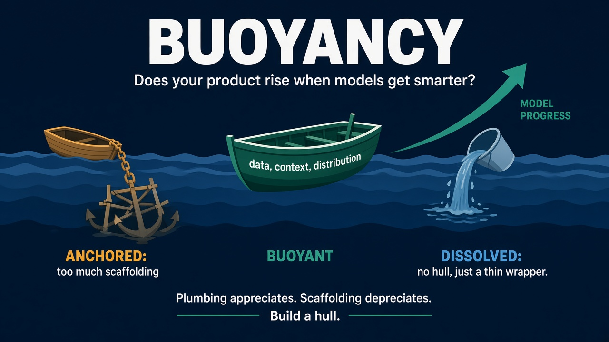
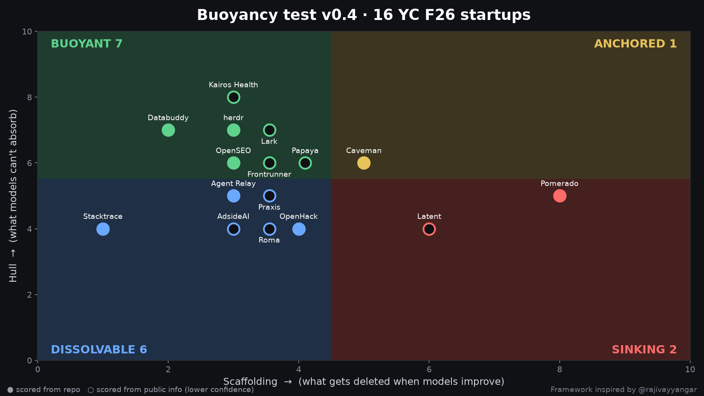

# Buoyancy Test

A framework and agent skill for assessing whether AI products, startups, or repositories are **buoyant** — meaning they improve automatically as AI models improve.

Based on Rajiv Ayyangar's essay ["Buoyancy"](https://blog.rajivayyangar.com/buoyancy/).

## What is Buoyancy?



AI products can be built with three types of components:

- **Plumbing**: Code that connects models to the problem. This *appreciates* as models get better — the same connection code delivers more value.
- **Scaffolding**: Code and prompts that compensate for weaknesses in current models or platforms. This *depreciates* as models improve and no longer need the workarounds.
- **Hull**: Assets that models don't acquire just by getting smarter — proprietary data, user context, distribution channels, workflow embedding, and problem ownership.

### Quadrants

Products fall into four categories:

| | Low Scaffolding (S ≤ 4) | High Scaffolding (S ≥ 5) |
|---|---|---|
| **Strong Hull (H ≥ 6)** | **Buoyant** 🚀<br>Rises with model improvements | **Anchored** ⚓<br>Defensible but needs cleanup |
| **Weak Hull (H ≤ 5)** | **Dissolvable** 🧊<br>Clean but undifferentiated | **Sinking** ⚖️<br>Compounding technical debt |

The buoyancy score B = H/10 - S/10 ranges from -1 (sinking) to +1 (buoyant).

## How to Use

### As a Cursor/Claude Agent Skill

Copy `skills/buoyancy-test/SKILL.md` to your Cursor skills directory (`~/.cursor/skills/` or similar). When you ask an AI agent to "run a buoyancy test on [repo/product]", it will follow the framework to:

1. Clone and analyze the repository
2. Score scaffolding (S), measurability (M), and hull (H)
3. Fill gaps with targeted questions or research
4. Generate a scorecard with actionable recommendations

### Manual Assessment

Use the full rubric in `FRAMEWORK.md` and the blank template in `templates/scorecard.md` to score projects yourself.

## Scoring Summary

**Scaffolding (0-10, lower is better)**
- Delete test: how much code becomes obsolete with a 2x better model?
- Prompt sediment: defensive instructions piled up over time
- Dependent chain depth: sequential model calls with dependencies
- Swap cost: effort to upgrade or switch providers
- Dependency brittleness: reliance on undocumented vendor behavior

**Measurability (0-2, reported separately)**
- Can you prove a new model is better within a day?

**Hull (0-10, higher is better, with confidence labels)**
- Proprietary/compounding context
- Sherlock risk: could a lab/platform ship this as a feature?
- Distribution: owned channels and customer relationships
- Workflow embedding: integration depth
- Problem ownership: task → workflow → outcome

## Example Results

> **See also**: [YC F26 Buoyancy Study](studies/yc-f26.md) — assessment of 16 YC Fall 2026 startups with key findings on vertical apps, coding-agent infra, and dependency brittleness.



### AI GitHub Profiler
**Dissolvable** (S=2/10, M=0/2, H=2/10, B=0.0)

A clean but undifferentiated GitHub profile analyzer. Low scaffolding with parallel API calls and native structured output, but no evals and minimal defensibility. Easy fixes available; hull opportunities include storing history and deeper LinkedIn/ATS integration.

[Full scorecard →](examples/ai-github-profiler.md)

### Herdr
**Buoyant** (S≈1-3/10, M=1/2, H=7/10, B≈0.5)

Terminal runtime for coding agents with minimal scaffolding and strong hull through workflow embedding. Some manifests brittleness in screen-text detection. Overlaps with Claude Code agent view (Sherlock risk).

[Full scorecard →](examples/herdr.md)

### Pomerado
**Sinking** (S=6/8 in v0.3, M=1/2, H=4/10, B≈-0.15)

Multi-agent minter + guardian reviewer chain with ~4,131 prompt lines including 444 rule-word lines. Heavy retry/recovery scaffolding. Durable deterministic integrations offer hull potential.

[Full scorecard →](examples/pomerado.md)

### Caveman
**Borderline** (S=4/8 in v0.3, M=2/2, H=6/10, B≈0.2)

Compression/voice features bet against cheaper models, but router + evals are buoyant. Model IDs scattered across 95 files increase swap cost.

[Full scorecard →](examples/caveman.md)

## Repository Structure

```
buoyancy-test/
├── README.md           # This file
├── FRAMEWORK.md        # Full rubric with rationale
├── CHANGELOG.md        # Version history
├── LICENSE             # MIT License
├── skills/
│   └── buoyancy-test/
│       └── SKILL.md    # Cursor/Claude agent skill
├── studies/
│   └── yc-f26.md       # 16 YC F26 startup study
├── examples/           # Real scorecards
│   ├── ai-github-profiler.md
│   ├── herdr.md
│   ├── pomerado.md
│   └── caveman.md
├── templates/
│   └── scorecard.md    # Blank template
└── assets/
    └── buoyancy_quadrant_16.png  # Quadrant chart
```

## Credits

Framework by Rajiv Ayyangar. Essay: [blog.rajivayyangar.com/buoyancy](https://blog.rajivayyangar.com/buoyancy/)

Current version: **v0.4** (see [CHANGELOG.md](CHANGELOG.md))

## License

MIT — see [LICENSE](LICENSE)
